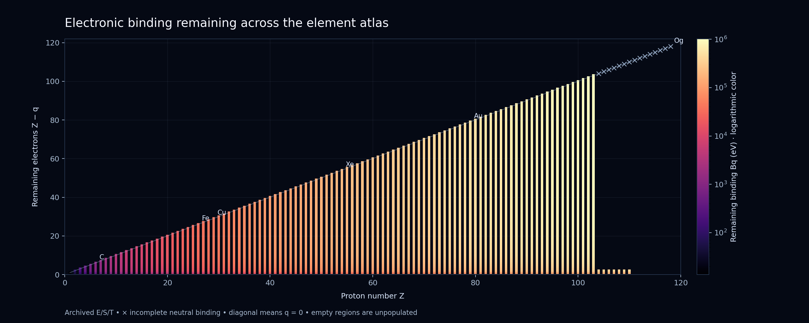
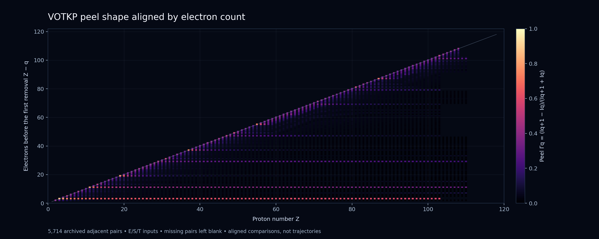

# Section 21 — Energy, states and transformation across the element atlas

Jeromie N. Beasley research programme — working formalization, 11 October 2026. Developed with AI assistance. This is a mathematical organizing model and arithmetic on the existing archive, not a new universal atomic dynamics or a fresh spectroscopy campaign.

## 21.1. Proposed statement

**An element supports a family of physical states. Energies compare those states, couplings determine their response and transformation channels, and physical feedback can change the operator and channel structure governing subsequent evolution.**

The state-energy ledger below is populated. State-resolved operators and feedback dynamics are requirements for the next extension. Energy, memory, entropy and projector geometry remain distinct quantities.

## 21.2. The same construction for every element

Fix nuclear species (Z,N) and environment/preparation X. Charge q leaves n=Z-q bound electrons. Each charge sector has an electronic Hilbert space, physical Hamiltonian H_q(X), ground energy E_q,0, excited energies E_q,a, a state rho_q, and an explicitly selected retained projector P_q. Resolved response also requires probe matrix elements and transition channels.

The archive's (Z,q) labels omit isotope and most preparation information. They are not complete microscopic states. Different charge Hamiltonians need not share nested projectors. Electron-number sectors can be organized by a direct sum, but physical ionization includes a free electron and radiative processes include radiation. A closed evolution must include those joint degrees of freedom.

## 21.3. Ground-energy reconstruction

Use a common electronic reference: the bare nucleus and free electrons at rest, with electron rest energies consistently removed. For a complete ladder,

\[
B_q=\sum_{j=q}^{Z-1}I_j,\qquad E_{q,0}=-B_q,\qquad E_{Z,0}=0.
\]

Then

\[
I_q=E_{q+1,0}-E_{q,0},\qquad
R_q=\sum_{j=0}^{q-1}I_j,\qquad E_{q,0}=R_q-B_0.
\]

B_q is the remaining binding and R_q the cumulative ground-state removal requirement. These are sector ground-energy differences under a common ledger. They do not determine excited spectra, eigenvectors, physical spatial shells or a full Hamiltonian.

Each threshold compares relaxed endpoints. Rearrangement is included in the resulting energy difference, but that difference alone cannot isolate a separate backreaction contribution.

An incomplete ladder gives only sums along known connected segments. A bare-reference energy needs a complete suffix q,...,Z-1; a neutral-reference sum needs a complete prefix 0,...,q-1. Unknown entries are not zero. B_Z=0 is a reference definition.

NIST defines electronic total binding through the ionization-energy sum. The archived entries carry E (evaluated), S (semi-empirical) or T (theoretical) grades. A complete ladder can still mix these grades. No uncertainty is assigned to the sum without an appropriate source/covariance procedure.

## 21.4. VOTKP and energy

Here q starts at zero, while IE_k in the original notation starts at k=1:

\[
\Gamma_q=\frac{I_{q+1}-I_q}{I_{q+1}+I_q},
\qquad I_{q+1}=I_q\frac{1+\Gamma_q}{1-\Gamma_q}.
\]

The full coordinate vector plus one absolute threshold reconstructs a connected block. Composition telescopes:

\[
\tanh\left(\sum_{q=a}^{b-1}\operatorname{artanh}\Gamma_q\right)
=\frac{I_b-I_a}{I_b+I_a}.
\]

This single net coordinate keeps an endpoint ratio; the full vector retains intermediate shape. B_q and R_q supply the energy ledger. Conversion I_q/h keeps the same ratios and is not a measured delay or a coherent internal charge-state oscillation.

## 21.5. Dynamics within a specified sector

For a physically calibrated quantum Hamiltonian and an identified clock parameter,

\[
\langle E\rangle=\operatorname{Tr}(\rho H),\qquad
i\hbar\dot\rho=[H,\rho],\qquad
\omega_{ab}=(E_a-E_b)/\hbar.
\]

Energy differences govern relative phase evolution. A stationary eigenstate can have constant observable density. Adding cI shifts the energy origin but leaves spectral projectors and relative phases unchanged. Projector geometry alone therefore does not fix an absolute energy origin. General framework operators need physical calibration before their eigenvalues are called energies. These evolution equations do not themselves derive the clock parameter in the memory-first time programme.

Actual response requires matrix elements as well as gaps. For a declared weak-probe dipole model a useful channel record is

\[
d\mathsf F_q(\Delta)=\sum_a2\Delta_{q,a}\,d_{q,a}d_{q,a}^{\dagger}
\delta(\Delta-\Delta_{q,a})\,d\Delta.
\]

This positive matrix measure records strength and direction. Units, probe conventions and any continuum contribution must be specified before applying sum rules or metric formulas. It is not populated by ionization energies alone.

## 21.6. Transformation, feedback and memory

For a differentiable finite model,

\[
\frac{d}{dt}\operatorname{Tr}(\rho H)
=\operatorname{Tr}(\dot\rho H)+\operatorname{Tr}(\rho\dot H).
\]

Under unitary evolution generated by H the first term vanishes. A time-independent closed joint Hamiltonian conserves total energy. A subsystem can exchange energy and have a changing effective operator. Assigning heat and work requires a physical partition and protocol.

A model may close feedback through H_q(X) and a responding environment X. Both the atom and that environment belong in the energy accounting. Stationary self-consistency iterations are distinct from physical evolution.

For the corpus's finite self-adjoint retained/hidden construction,

\[
H=\begin{pmatrix}A&C\\C^\dagger&D\end{pmatrix},
\quad d\mathsf M(E)=C\,d\mathsf E_D(E)C^\dagger,
\]
\[
\Sigma(z)=\int\frac{d\mathsf M(E)}{z-E},\qquad
K(t)=\int e^{-iEt/\hbar}d\mathsf M(E).
\]

Cauchy contours select channel contributions from Sigma under the stated analytic hypotheses. A same-H spectral projector gives C=0; a nontrivial reduction needs a physical configuration split. This measure and the optical measure are distinct until a compatible model relates them. Atomic ionization continua require domain and convergence control beyond the finite construction.

## 21.7. Translation across atoms

The shared object is the construction rule; the energy levels, strengths, state symmetries and nuclear records differ by element. At fixed Z the charge stages form chains. At fixed n=Z-q one obtains isoelectronic comparisons across nuclei. At fixed q one compares neutral or ionic element series. Resolved excitation and reaction channels add branches. Isotope decay needs its own nuclear record.

A spiral may display recurring families, while a layered state graph retains process distinctions. No universal oscillator or preferred spiral is assumed.

Quantum amplitudes can interfere and measurements can register discrete events. The threshold atlas does not determine a spatial wavefunction or establish one coherent wave for all matter. Persistent quantum states with structured transformation channels is a useful working language.

## 21.8. Ten concrete translations

All numbers below are arithmetic on archived values. Total binding mixes E/S/T entries. Display precision is not an uncertainty claim.

| Element | IE1 (eV) | Total binding (keV) | Translation |
|---|---:|---:|---|
| H | 13.598435 | 0.013598 | One removal edge; no adjacent peel. |
| Li | 5.391715 | 0.203486 | Three charge steps separate outer removal from subsequent costs. |
| C | 11.260288 | 1.030108 | Six steps give seven ground-energy ledger points. |
| N | 14.534130 | 1.486058 | Compare its full ladder with O, not just IE1. |
| O | 13.618055 | 2.043843 | Its first threshold is lower than N; actual records govern the order. |
| Fe | 7.902468 | 34.619321 | Twenty-six steps; response branching remains additional information. |
| Cu | 7.726380 | 45.002586 | Absolute scale and peel shape are distinct comparisons. |
| Xe | 12.129844 | 202.399388 | Binding total is available; delay still needs response phase. |
| Au | 9.225554 | 517.177249 | Total binding is substantial; atom and film conditions remain distinct. |
| Og | unknown | unknown | No archived thresholds; energies remain unknown. |

## 21.9. Coverage and checks

All 118 slots were processed: 110 have thresholds, 103 have complete ladders, and 5,847 thresholds are retained. Successful checks:

- state energy edge checks: 5370.
- complete ladder reference checks: 103.
- peel inverse checks: 5714.

The reconstructed ledger is not a full operator reconstruction. No response strengths, lifetimes, isotope masses or feedback coefficients were invented. Electronic binding contributes B/c² to a consistently defined mass defect; nuclear binding requires its own ledger.

## 21.10. Every element

Complete means every threshold q=0,...,Z-1 exists. An incomplete sum is not called total binding.

| Z | Element | Thresholds / Z | Complete | IE1 (eV) | Total binding (keV) | E/S/T |
|---:|---|---:|---|---:|---:|---|
| 1 | H | 1/1 | yes | 13.598435 | 0.013598 | 0/0/1 |
| 2 | He | 2/2 | yes | 24.587389 | 0.079005 | 1/0/1 |
| 3 | Li | 3/3 | yes | 5.391715 | 0.203486 | 1/0/2 |
| 4 | Be | 4/4 | yes | 9.322699 | 0.399149 | 2/0/2 |
| 5 | B | 5/5 | yes | 8.298019 | 0.670984 | 3/0/2 |
| 6 | C | 6/6 | yes | 11.260288 | 1.030108 | 4/0/2 |
| 7 | N | 7/7 | yes | 14.534130 | 1.486058 | 3/2/2 |
| 8 | O | 8/8 | yes | 13.618055 | 2.043843 | 4/2/2 |
| 9 | F | 9/9 | yes | 17.422820 | 2.715891 | 4/3/2 |
| 10 | Ne | 10/10 | yes | 21.564541 | 3.511697 | 6/2/2 |
| 11 | Na | 11/11 | yes | 5.139077 | 4.419969 | 3/5/3 |
| 12 | Mg | 12/12 | yes | 7.646236 | 5.451072 | 3/6/3 |
| 13 | Al | 13/13 | yes | 5.985769 | 6.604952 | 4/6/3 |
| 14 | Si | 14/14 | yes | 8.151680 | 7.888522 | 5/6/3 |
| 15 | P | 15/15 | yes | 10.486686 | 9.305790 | 4/8/3 |
| 16 | S | 16/16 | yes | 10.360010 | 10.859598 | 6/7/3 |
| 17 | Cl | 17/17 | yes | 12.967633 | 12.556443 | 5/9/3 |
| 18 | Ar | 18/18 | yes | 15.759612 | 14.400856 | 3/12/3 |
| 19 | K | 19/19 | yes | 4.340664 | 16.382422 | 3/13/3 |
| 20 | Ca | 20/20 | yes | 6.113155 | 18.510103 | 4/13/3 |
| 21 | Sc | 21/21 | yes | 6.561490 | 20.787893 | 6/12/3 |
| 22 | Ti | 22/22 | yes | 6.828120 | 23.221324 | 7/12/3 |
| 23 | V | 23/23 | yes | 6.746187 | 25.819344 | 7/13/3 |
| 24 | Cr | 24/24 | yes | 6.766510 | 28.582028 | 4/17/3 |
| 25 | Mn | 25/25 | yes | 7.434038 | 31.514095 | 5/17/3 |
| 26 | Fe | 26/26 | yes | 7.902468 | 34.619321 | 9/14/3 |
| 27 | Co | 27/27 | yes | 7.881010 | 37.900131 | 5/19/3 |
| 28 | Ni | 28/28 | yes | 7.639878 | 41.354904 | 4/19/5 |
| 29 | Cu | 29/29 | yes | 7.726380 | 45.002586 | 4/20/5 |
| 30 | Zn | 30/30 | yes | 9.394197 | 48.840900 | 4/22/4 |
| 31 | Ga | 31/31 | yes | 5.999302 | 52.861386 | 4/16/11 |
| 32 | Ge | 32/32 | yes | 7.899435 | 57.077608 | 6/15/11 |
| 33 | As | 33/33 | yes | 9.788550 | 61.470775 | 6/15/12 |
| 34 | Se | 34/34 | yes | 9.752368 | 66.068036 | 6/16/12 |
| 35 | Br | 35/35 | yes | 11.813810 | 70.863003 | 7/16/12 |
| 36 | Kr | 36/36 | yes | 13.999605 | 75.865753 | 5/18/13 |
| 37 | Rb | 37/37 | yes | 4.177128 | 81.048431 | 4/19/14 |
| 38 | Sr | 38/38 | yes | 5.694867 | 86.440143 | 5/19/14 |
| 39 | Y | 39/39 | yes | 6.217260 | 92.029404 | 6/21/12 |
| 40 | Zr | 40/40 | yes | 6.634126 | 97.825640 | 4/21/15 |
| 41 | Nb | 41/41 | yes | 6.758850 | 103.830374 | 5/22/14 |
| 42 | Mo | 42/42 | yes | 7.092430 | 110.065684 | 5/24/13 |
| 43 | Tc | 43/43 | yes | 7.119380 | 116.487808 | 1/19/23 |
| 44 | Ru | 44/44 | yes | 7.360500 | 123.150964 | 2/19/23 |
| 45 | Rh | 45/45 | yes | 7.458900 | 130.033151 | 1/20/24 |
| 46 | Pd | 46/46 | yes | 8.336839 | 137.141044 | 1/20/25 |
| 47 | Ag | 47/47 | yes | 7.576234 | 144.480603 | 2/19/26 |
| 48 | Cd | 48/48 | yes | 8.993820 | 152.046287 | 3/17/28 |
| 49 | In | 49/49 | yes | 5.786356 | 159.851438 | 4/18/27 |
| 50 | Sn | 50/50 | yes | 7.343918 | 167.892692 | 5/15/30 |
| 51 | Sb | 51/51 | yes | 8.608389 | 176.144825 | 5/3/43 |
| 52 | Te | 52/52 | yes | 9.009808 | 184.652775 | 6/2/44 |
| 53 | I | 53/53 | yes | 10.451236 | 193.401698 | 6/4/43 |
| 54 | Xe | 54/54 | yes | 12.129844 | 202.399388 | 5/7/42 |
| 55 | Cs | 55/55 | yes | 3.893906 | 211.628360 | 3/4/48 |
| 56 | Ba | 56/56 | yes | 5.211665 | 221.101222 | 3/4/49 |
| 57 | La | 57/57 | yes | 5.576900 | 230.824919 | 3/5/49 |
| 58 | Ce | 58/58 | yes | 5.538600 | 240.804538 | 1/7/50 |
| 59 | Pr | 59/59 | yes | 5.470200 | 251.060196 | 1/6/52 |
| 60 | Nd | 60/60 | yes | 5.525000 | 261.584448 | 1/6/53 |
| 61 | Pm | 61/61 | yes | 5.581870 | 272.377390 | 1/5/55 |
| 62 | Sm | 62/62 | yes | 5.643722 | 283.454942 | 1/6/55 |
| 63 | Eu | 63/63 | yes | 5.670385 | 294.803500 | 1/6/56 |
| 64 | Gd | 64/64 | yes | 6.149800 | 306.422726 | 1/5/58 |
| 65 | Tb | 65/65 | yes | 5.863800 | 318.334267 | 1/5/59 |
| 66 | Dy | 66/66 | yes | 5.939061 | 330.558316 | 1/5/60 |
| 67 | Ho | 67/67 | yes | 6.021500 | 343.075933 | 1/5/61 |
| 68 | Er | 68/68 | yes | 6.107700 | 355.895024 | 1/5/62 |
| 69 | Tm | 69/69 | yes | 6.184402 | 369.029959 | 1/5/63 |
| 70 | Yb | 70/70 | yes | 6.254160 | 382.457206 | 2/4/64 |
| 71 | Lu | 71/71 | yes | 5.425871 | 396.209334 | 2/4/65 |
| 72 | Hf | 72/72 | yes | 6.825070 | 410.249555 | 1/3/68 |
| 73 | Ta | 73/73 | yes | 7.549571 | 424.569672 | 2/4/67 |
| 74 | W | 74/74 | yes | 7.864030 | 438.987004 | 2/69/3 |
| 75 | Re | 75/75 | yes | 7.833520 | 454.144434 | 2/4/69 |
| 76 | Os | 76/76 | yes | 8.438230 | 469.448058 | 1/4/71 |
| 77 | Ir | 77/77 | yes | 8.967020 | 485.001507 | 1/4/72 |
| 78 | Pt | 78/78 | yes | 8.958830 | 500.896259 | 3/3/72 |
| 79 | Au | 79/79 | yes | 9.225554 | 517.177249 | 3/3/73 |
| 80 | Hg | 80/80 | yes | 10.437504 | 533.832424 | 7/3/70 |
| 81 | Tl | 81/81 | yes | 6.108287 | 550.807349 | 5/3/73 |
| 82 | Pb | 82/82 | yes | 7.416680 | 568.143519 | 4/4/74 |
| 83 | Bi | 83/83 | yes | 7.285516 | 585.860985 | 5/4/74 |
| 84 | Po | 84/84 | yes | 8.418070 | 603.926518 | 1/3/80 |
| 85 | At | 85/85 | yes | 9.317510 | 622.296318 | 1/5/79 |
| 86 | Rn | 86/86 | yes | 10.748500 | 641.057439 | 1/2/83 |
| 87 | Fr | 87/87 | yes | 4.072741 | 660.204973 | 1/3/83 |
| 88 | Ra | 88/88 | yes | 5.278424 | 679.733026 | 2/1/85 |
| 89 | Ac | 89/89 | yes | 5.380235 | 699.585066 | 1/4/84 |
| 90 | Th | 90/90 | yes | 6.306700 | 719.895575 | 3/2/85 |
| 91 | Pa | 91/91 | yes | 5.890000 | 740.488990 | 0/5/86 |
| 92 | U | 92/92 | yes | 6.194050 | 761.522794 | 4/2/86 |
| 93 | Np | 93/93 | yes | 6.265540 | 783.005466 | 1/3/89 |
| 94 | Pu | 94/94 | yes | 6.025760 | 804.765726 | 1/3/90 |
| 95 | Am | 95/95 | yes | 5.973810 | 827.254474 | 1/3/91 |
| 96 | Cm | 96/96 | yes | 5.992241 | 849.924392 | 1/3/92 |
| 97 | Bk | 97/97 | yes | 6.197850 | 873.153398 | 1/3/93 |
| 98 | Cf | 98/98 | yes | 6.281878 | 896.750682 | 1/3/94 |
| 99 | Es | 99/99 | yes | 6.368400 | 920.816468 | 1/3/95 |
| 100 | Fm | 100/100 | yes | 6.500000 | 945.264600 | 0/4/96 |
| 101 | Md | 101/101 | yes | 6.580000 | 970.461380 | 0/4/97 |
| 102 | No | 102/102 | yes | 6.626210 | 996.263856 | 1/2/99 |
| 103 | Lr | 103/103 | yes | 4.960000 | 1022.487900 | 1/1/101 |
| 104 | Rf | 69/104 | no | 6.020000 | unknown | 0/0/69 |
| 105 | Db | 70/105 | no | 6.800000 | unknown | 0/0/70 |
| 106 | Sg | 71/106 | no | 7.800000 | unknown | 0/6/65 |
| 107 | Bh | 72/107 | no | 7.700000 | unknown | 0/7/65 |
| 108 | Hs | 73/108 | no | 7.600000 | unknown | 0/8/65 |
| 109 | Mt | 68/109 | no | unknown | unknown | 0/0/68 |
| 110 | Ds | 68/110 | no | unknown | unknown | 0/0/68 |
| 111 | Rg | 0/111 | no | unknown | unknown | 0/0/0 |
| 112 | Cn | 0/112 | no | unknown | unknown | 0/0/0 |
| 113 | Nh | 0/113 | no | unknown | unknown | 0/0/0 |
| 114 | Fl | 0/114 | no | unknown | unknown | 0/0/0 |
| 115 | Mc | 0/115 | no | unknown | unknown | 0/0/0 |
| 116 | Lv | 0/116 | no | unknown | unknown | 0/0/0 |
| 117 | Ts | 0/117 | no | unknown | unknown | 0/0/0 |
| 118 | Og | 0/118 | no | unknown | unknown | 0/0/0 |

## Provenance

Input: Element_atlas_with_crosspaper_relations.json from the delivered VOTKP v2.3 integration package. This pass did not refresh the numerical archive against live NIST data. The current Element_crosspaper_synthesis.md and Relational_periodic_table_matter_and_transformation_20261011.md were read in the preceding energy discussion. Their source restrictions remain in force.

[NIST ionization and binding documentation](https://physics.nist.gov/PhysRefData/ASD/Html/iehelp.html); [Tong, quantum formalism](https://www.damtp.cam.ac.uk/user/tong/qm/qmhtml/S3.html).

Input SHA-256: b792eb46d426d60ef6944139e2103734f8b52dca428a346549c3318262787d56.

## Lean proof correspondence

The new module VOTKP/Energy.lean contains 17 theorem statements with proofs. Local/CI Lean certification is pending until the proof check completes; the arithmetic data controls have passed.

| Result | Lean declaration |
|---|---|
| Removal recurrence | removed_succ |
| Neutral and bare binding | binding_neutral; binding_bare |
| Removal plus remaining binding | ledger_decomposition |
| Binding decrement and ground-energy difference | binding_succ; ground_step |
| Reference conversion and telescope | ground_reference; energy_telescope |
| Nonnegative remaining binding under stated hypotheses | binding_nonnegative |
| Energy-origin invariance | energy_origin_invariance |
| Peel with an anchor reconstructs a threshold | peel_anchor_reconstruction |
| Binding changes under energy rescaling | binding_scale |
| One threshold does not determine total binding | first_threshold_not_total |

These are finite real-arithmetic identities. They do not certify empirical input values, excited-state spectra, a universal atomic feedback model or nuclear decay. The same-gap example is a scalar weighted-readout control, not a formal atomic response theorem. The optical/channel and dynamical equations in the section remain model constructions outside this Lean module.

## New visual

Every colored point is a supported remaining-binding sum B_q, including theoretical and semi-empirical inputs. Vertical columns are charge ladders; horizontal rows align the remaining electron count. The diagonal follows the definition q=0, not a discovered geometric law. Blank or crossed records retain missing data; zero binding at the bare endpoint is omitted from logarithmic color. The drawing displays no measured trajectory or reaction branching.

## Reproduction

Run python3 scripts/verify_energy_data.py for exact rational controls on the archived decimal energies. Add --figure to regenerate the figure with matplotlib. Run lake build and python3 scripts/verify.py for Lean compilation, the axiom audit and false controls. The repository workflow independently replays the listed modules with leanchecker.

### Peel-shape view

This complementary view colors the 5,714 adjacent threshold comparisons by Gamma. Horizontal bands are visible in the archived isoelectronic alignment. Among well-populated rows, the n=3, n=11 and n=29 rows have median Gamma about 0.6086, 0.3869 and 0.2574 respectively. Their sample sizes are 101, 100 and 82. The n=3 row contains 93 T/T pairs and no E/E pairs; n=11 has only 6 E/E pairs; n=29 has 9. Across the whole image, only 156 pairs are E/E. These are features of a mixed evaluated/model archive, not an independent experimental discovery or a new shell law. Neither a horizontal family comparison nor a drawn column is a trajectory.
