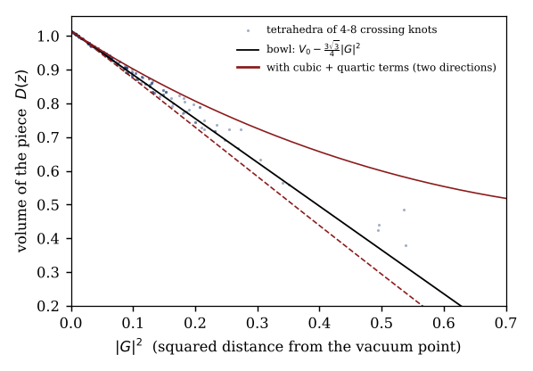
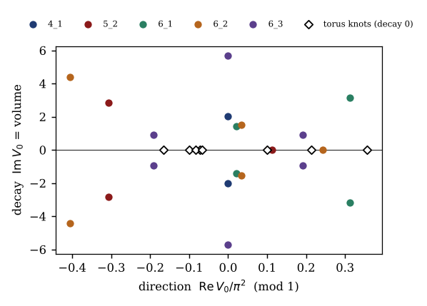
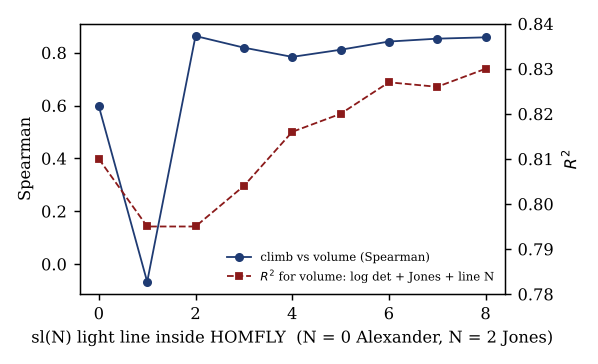

*AI-assisted: computations, drafting and literature checks were carried out with Claude (Anthropic) and helper agents, from the author's ideas and earlier papers; all numbers come from scripts listed in Appendix C and the attached archive.*

## Abstract

VOTKP began as the *volume of the knot potential*, an attempt to read the volume of the space around a knot from its polynomials. It then became the *vector of traits kept under peeling*. This paper joins the two meanings through the two books of the intrinsic quantum geometric tensor $Q = g - \tfrac{i}{2}\Omega$: a climb (metric, size) and a turn (curvature, phase). The reading is set on a Smith-type disk whose centre is the vacuum and whose rim is ground.

- **The vacuum disk.** Every ideal tetrahedron of a hyperbolic knot complement is placed on a disk centred on the regular tetrahedron. On that disk:
  - the three ways of reading a tetrahedron are exact $120^\circ$ turns, which is the tennis-racket switch: the axis changes, the volume does not;
  - flat tetrahedra lie on the rim, and mirrors lie outside it.
- **Decay.** A tetrahedron's volume is a bowl around the vacuum, with the exact series $D = V_0 - \tfrac{3\sqrt3}{4}|G|^2 + \tfrac{\sqrt3}{8}(G^3+\bar G^3) + \tfrac{3\sqrt3}{16}|G|^4 + O(|G|^5)$. Summed over the pieces, with nothing fitted, it gives the volume of 12,954 knots to a median error of 0.076%.
- **Direction.** The Chern–Simons twist lives in integer windings. With the pieces read in a branching order it is reproduced exactly (454 of 454 runs).
- **Our polynomial.** The knot potential read straight off a drawing gives one (decay, direction) root per geometry.
  - On 79 of 79 hyperbolic knots, its top root is the knot's complex volume.
  - Its spectrum is the same from different drawings (13 of 13 knots tested).
  - The true geometry is always the root nearest the vacuum (31 of 31).
  - Torus knots give pure-direction roots: zero decay, a rational fraction of a turn. The knots that assemble themselves in chemistry are exactly of this kind.
- **Supporting lines.** Light strings (Jones, HOMFLY along its sl(N) lines), the colour of the elements on the same disk, and the electron's group $\mathrm{SL}(2,\mathbb C)$ complete the chain.
- **Status.** Reproductions of known mathematics, new readings and new results are marked throughout and listed in Section 12.

## 1. Where this comes from

**Three papers feed this one.**

- **IQGT** (*Intrinsic Quantum Geometric Tensor*, v7.3.1). For a projector path, the tensor $Q = g - \tfrac{i}{2}\Omega$ splits into two books.
  - The metric $g = \tfrac12\mathrm{Tr}(VW)$ measures how far a state moves: the *climb*.
  - The curvature $\Omega = +i\,\mathrm{Tr}(\Pi[V,W]) = -2\,\mathrm{Im}\,Q$ measures how it turns: the *turn*.
  - A loop that comes back still remembers, through its phase (IQGT Ex. 6.5).
  - The Smith coordinate $\Gamma = (z-1)/(z+1) = \tanh(\tfrac12\ln z)$ puts any impedance-like quantity on a disk: the centre $\Gamma=0$ is the matched point (vacuum) and the rim $|\Gamma|=1$ is total reflection (ground).
- **Dirac Time** (*Dirac Time of the Gigantefermion*, v3.1). Torus knots, their arcs and signatures, and the chiral pairing $\Gamma P_+\Gamma = P_-$. The torus knots return here as the pure-direction roots.
- **VOTKP** (*Elemental Peeling*, v2.9). Peeling kept a vector of traits, Levine–Tristram walls and colour; v2.9 Table 6 has 575 double roots. Its first meaning, the volume of the knot potential, mixing HOMFLY and coloured Jones to map volume, is the question this paper answers.

**The tennis racket.** A body spun about its middle axis flips over and over (the Dzhanibekov effect). The angular momentum keeps its size and its direction in space. What builds up is a turn, a geometric phase set by the area the switching sweeps (Montgomery). In an earlier part of this research the climb rate of that switch matched the Connection Energy formula (0.577350), and the memory was a lune $4\arctan k$ that reaches $45^\circ$ when the middle level sits midway. The rule *the axis switches, the direction stays* is the organising rule of everything below.

## 2. The vacuum disk for knot pieces

A hyperbolic knot complement is glued from ideal tetrahedra. Each has a shape $z$ with $\mathrm{Im}\,z>0$, a cross-ratio of its four ideal vertices. Its volume is the Bloch–Wigner dilogarithm
$$D(z) = \mathrm{Im}\,\mathrm{Li}_2(z) + \arg(1-z)\,\log|z| .$$
Let $w = e^{i\pi/3}$, the shape of the regular ideal tetrahedron, with $V_0 = D(w) = 1.0149416064\ldots$, the largest possible. Define the **vacuum disk**
$$G(z) = \frac{z-w}{z-\bar w}.$$

**Proposition 1 (vacuum, rim, mirror, racket).**

(a) $G(w)=0$: the regular tetrahedron is the vacuum point.

(b) Real $z$ (a flat tetrahedron, $D=0$) gives $|G|=1$: flat pieces lie on the rim.

(c) The mirror shape $\bar z$ gives $|G(\bar z)| = 1/|G(z)|$: mirrors lie outside the disk.

(d) The axis switch $T(z) = 1/(1-z)$, which relabels the tetrahedron's edges ($z\to z'\to z''$), acts on $G$ as an exact rotation, $G(T z) = e^{2\pi i/3}\,G(z)$, while $D(Tz)=D(z)$.

*Proof.*

- (a) is immediate.
- (b): for real $z$, $|z-w| = |z-\bar w|$, because $\bar w$ is the reflection of $w$ in the real line.
- (c): $G(\bar z) = (\bar z - w)/(\bar z-\bar w) = \overline{(z-\bar w)/(z-w)} = \overline{G(z)}^{-1}$.
- (d), step 1: $T$ is a Möbius map of order 3 whose fixed points are the roots of $z^2-z+1=0$, namely $w$ and $\bar w$.
- (d), step 2: a Möbius map with fixed points $w,\bar w$ becomes, in the coordinate $G$ that sends $w\mapsto 0$ and $\bar w\mapsto\infty$, multiplication by its multiplier at $w$.
- (d), step 3: that multiplier is $T'(w) = 1/(1-w)^2 = 1/e^{-2i\pi/3} = e^{2\pi i/3}$.
- (d), step 4: the invariance $D(z)=D(1/(1-z))=D(1-1/z)$ is the classical symmetry of the Bloch–Wigner function. $\square$

*Checked numerically:* for $z = 0.3+1.1i$ the three labels sit at radius $0.1557583601$, at $34.715^\circ$, $154.715^\circ$ and $-85.285^\circ$, with identical $D = 0.9832288623$. *Status:* (a)–(c) are elementary; (d) is a new reading of a classical symmetry; the racket interpretation is ours.

{width=70%}

## 3. Decay: the vacuum bowl

**Theorem 2 (bowl series).** Near the vacuum point,
$$D(z) = V_0 - \frac{3\sqrt3}{4}|G|^2 + \frac{\sqrt3}{8}\left(G^3+\bar G^3\right) + \frac{3\sqrt3}{16}|G|^4 + O(|G|^5).$$
*Status:* derived symbolically (sympy expansion of $D$ in the coordinate $G$) and confirmed numerically. $(V_0-D)/|G|^2 \to 1.2990$ against $3\sqrt3/4 = 1.29904$, and the residual scales as $|G|^5$.

**What each term means.**

- The quadratic term is a round bowl: volume drops with squared distance from the vacuum.
- The cubic term is the racket written exactly. It has the three-fold symmetry of Proposition 1(d) and nothing else.
- The quartic term is the next radial correction.

**The knot law (nothing fitted).** A knot's volume is the sum of its pieces,
$$\mathrm{Vol}(K) = \sum_j D(z_j) \approx \sum_j \Big[V_0 - \tfrac{3\sqrt3}{4}|G_j|^2 + \dots\Big].$$

| Law | Knots | Median error | 90th pct | Worst |
|---|---|---|---|---|
| pieces all at full volume, $nV_0$ | 243 | 10.9% | | |
| bowl, quadratic only | 243 | 0.27% | 0.96% | 13% (10_1) |
| bowl, quadratic only | 12,954 | 0.21% | 0.62% | 19.9% (12a_803) |
| bowl + cubic | 12,954 | 0.39% | 0.90% | 27% |
| **bowl + cubic + quartic** | **12,954** | **0.076%** | **0.31%** | **11.4% (11a_247)** |
| opposite: hyperbolic distance | 12,954 | 1.3% | 3.2% | >200% |

- **The cubic needs the quartic.** The racket term alone over-corrects; it only helps once the quartic term is included. With both, 12a_803 improves from $-19.9\%$ to $-4.5\%$.
- **Most pieces sit near the vacuum.** Real knots keep most of their pieces close in: 1,391 of 2,777 tetrahedra lie within hyperbolic distance 0.5. That is why the bowl works.
- **Reading.** *A knot's volume is its pieces at full volume, minus how far each one sits from the vacuum.* This is the decay book.

{width=70%}

## 4. Every geometry, and the one nearest the vacuum

A knot's gluing equations (edges plus meridian completeness) have more than one solution. Besides the true hyperbolic structure there are its mirror, flat solutions and Galois-conjugate ones. Each is a different way of putting a geometry on the knot.

**Method.** All solutions were found by damped Newton iteration from 3,000 random starts.

**Results** (31 hyperbolic knots up to 8 crossings, 291 solutions):

| Check | Result |
|---|---|
| true geometry = smallest $\sum|G_j|^2$ (nearest the vacuum) | 31 of 31 |
| true geometry = largest volume | 31 of 31 (known: Francaviglia; Cho) |
| mirrors outside the disk | always |
| all-real solutions | $\sum|G_j|^2 = n$ exactly (on the rim, Prop. 1b) |
| within-knot order: $\sum|G|^2$ against volume | median Spearman $-0.905$ |
| ladder breaks between two fully-inside solutions | none of 136 inversions |

**Where the ladder breaks.**

- Every break involves a flat solution or a mixed one, with pieces on both sides of the rim.
- Counting outside pieces as mirrored, $\varepsilon_j[V_0 - k|\tilde G_j|^2]$ with $\tilde G = 1/\bar G$ and $\varepsilon=-1$ outside, restores the order: median Spearman $0.995$.
- Example (6_1): $\sum|G|^2 = 0.74, 5.1, 28.9, 47.3$ against volumes $3.164, 1.415, -1.415, -3.164$.

*Reading:* **the knot's geometry is the root nearest the vacuum.** It is known that the geometric solution maximises volume; that it is the one nearest the vacuum, with the bowl law as the reason, is our reading.

## 5. Direction: the twist lives in integers

The complex volume $\mathrm{Vol} + i\,\mathrm{CS}$ has a second half, the Chern–Simons invariant.

**Null result first.** In the experiments it was *not* found in the angles of the pieces: the summed three-fold angle of $G$ against CS gives $\rho = 0.02$.

**Neumann's formula.** Give each tetrahedron log-parameters
$$w_0 = \log z + p\pi i,\quad w_1 = \log z' + q\pi i,\quad w_2 = -w_0-w_1, \qquad z' = \tfrac1{1-z},$$
with integers $p,q$ (the windings) chosen so that every edge and both cusp curves have total log-parameter $0$ (a flattening; Zickert, Def. 6.1). Then
$$i(\mathrm{Vol}+i\,\mathrm{CS}) = \sum_j \varepsilon_j\,R(z_j;p_j,q_j),$$
$$R(z;p,q) = \mathrm{Li}_2(z) + \tfrac12\log z\log(1-z) + \tfrac{\pi i}{2}\big(q\log z + p\log(1-z)\big) - \tfrac{\pi^2}{6}.$$

**Results.**

- The integer system was solved exactly (PARI `matsolvemod`) for 79 hyperbolic knots of 4–9 crossings.
- **Volume** needs no integers: it matches SnapPy to $5\times10^{-14}$.
- **Chern–Simons**, with the windings, first matched only up to $\pm\pi^2/6$ on 54 knots.
  - The cause: $R$ is not invariant under relabelling a tetrahedron. $R(z';q,r)-R(z;p,q) = (1+3q)\pi^2/6$.
  - The fix: read every tetrahedron in a *branching* order (a vertex order with order-preserving gluings, found on all 79). Odd permutations invert the shape and negate the integers ($\varepsilon=-1$).
  - With that, CS is exact in **454 of 454** runs (79 knots × up to 6 branchings), to $2.7\times10^{-14}$, modulo SnapPy's period $\pi^2/2$.
- **The windings are essential.** With them dropped, the continuous part alone matches 1 of 79.

**Reading.** The two books separate in the knot's own geometry. *Decay (volume) is continuous: distance from the vacuum. Direction (twist) is integer: how many half-turns each piece's phase winds.* This is the IQGT split $Q = g-\tfrac i2\Omega$ again, and it is the phase winding the author's work began with.

*Status:* reproduction of Neumann's theorem; the branching fix is standard. The two-book reading is ours.

## 6. Our polynomial, read off the drawing

**The potential.** Cho–Kim–Kim (2013) define a potential of a knot *diagram*.

- One variable $z_k$ per side; each crossing with sides $(a,b,c,d)$ adds
$$\mathrm{Li}_2\!\left(\tfrac{z_b}{z_a}\right)-\mathrm{Li}_2\!\left(\tfrac{z_b}{z_c}\right)+\mathrm{Li}_2\!\left(\tfrac{z_d}{z_c}\right)-\mathrm{Li}_2\!\left(\tfrac{z_d}{z_a}\right).$$
- The hyperbolicity equations $\exp(z_k\,\partial V/\partial z_k)=1$ are products of $(1-\text{ratio})^{\pm1}$, so no logarithm branch has to be chosen.
- The modified potential $V_0 = V-\sum_k (z_k\partial_k V)\log z_k$ gives $i(\mathrm{Vol}+i\,\mathrm{CS})$ at the geometric solution (CKK Thm 1.2).
- This is, literally, *the volume of the knot potential*.

**Reading any drawing.**

- The placement of the four sides at a crossing appears in the source only as a figure, so all 64 placements were tested against SnapPy.
- One rule survives, up to the term's symmetry $(a\leftrightarrow c,\ b\leftrightarrow d)$: $(b,d)$ is the under-strand pair of the PD crossing $X[i,j,k,l]$, the same for both signs.
- A kinked crossing $X[i,j,j,l]$ is singular and must be removed.

**The finite object.**

- The solutions come in continuous families: no single ratio or cross-ratio is fixed along them.
- Only $V_0$ is constant on each family. So the drawing gives one complex number per family, that is, per boundary-parabolic geometry.
- Its imaginary part is the **decay** (volume of that geometry); its real part is the **direction** ($-\mathrm{CS}$ mod $\pi^2$).
- We define the knot's **decay–direction polynomial**
$$P_K(x) = \prod_{\rho}\Big(x - e^{\lambda V_0(\rho)}\Big),$$
one root per geometry, with $\lambda$ chosen to map the $\pi^2$ period to a full turn. Its roots carry the two books directly.

**Results.**

| Test | Result |
|---|---|
| top root = SnapPy complex volume (vol to $10^{-6}$, CS to $10^{-5}$) | 79 of 79 hyperbolic knots, 4–9 crossings |
| same full spectrum from three different drawings (one with 2 extra crossings) | 13 of 13 knots |
| spectrum volumes = the ladder of Section 4 | exact |

The search is a budget question, not a convergence question: on hard knots about one random start in a thousand reaches the geometric family.

| Knot | Every geometry as (decay, direction) | SnapPy |
|---|---|---|
| 4_1 | (2.02988, 0); mirror | (2.02988, 0) |
| 5_2 | (2.82812, −3.0241), (0, 1.1135); mirror | (2.82812, −3.0241) |
| 6_1 | (3.16396, 3.0789), (1.4151, 0.211); mirrors | (3.16396, 3.0789) |
| 6_2 | (4.40083, −3.997), (1.53058, 0.3291), (0, 2.4011); mirrors | (4.40083, −3.997) |
| 6_3 | (5.69302, 0), (0.9243, ±1.8906); mirrors | (5.69302, 0) |

*Caveat:* SnapPy's named manifold is the mirror of the KnotInfo drawing for 42 of the 79 knots. Signed comparisons must use the exterior of the drawing itself.

{width=72%}

**Torus knots: pure direction.** On 3_1, 5_1, 7_1, 8_19 and 10_124 every valid root has decay $0$ (to $10^{-15}$), and every direction is an exact rational multiple of $\pi^2$:

| Knot | Directions (fraction of $\pi^2$, mod 1) |
|---|---|
| 3_1 = T(2,3) | 5/6 |
| 5_1 = T(2,5) | 1/10, 9/10 |
| 7_1 = T(2,7) | 3/14, 5/14, 13/14 |
| 8_19 = T(3,4) | 11/12 |
| 10_124 = T(3,5) | 14/15 |

- All values fit $-k^2/(pq)$ mod 1.
- *Status:* reproduction. These are the Chern–Simons values of torus-knot representations (Kirk–Klassen; computed explicitly by Dubois–Kashaev and Murakami).
- The known count of components, $(a-1)(b-1)/2$, matches $T(2,q)$ exactly. It predicts 3 directions for 8_19 and 4 for 10_124, of which our search found 1 each: a clean target for the next run.

## 7. Light strings: Jones and HOMFLY

**The Jones string.**

- Let $t=e^{i\theta}$ run once around the circle, as colour runs from violet to red, and follow the Jones polynomial $V(t)$. Because $V(1)=1$, the string leaves one point and returns to it.
- **Climb** is the Mahler measure (mean of $\log|V|$).
- **Turn** is the signed area swept, divided by the mean of $|V|^2$.

On 2,970 hyperbolic knots up to 12 crossings (and 9,985 at 13 crossings in an independent run):

| Quantity | Against | Result |
|---|---|---|
| climb | volume | $\rho = 0.854$ (independent run: $0.8542$) |
| climb, after log det | volume left over | $\rho = 0.50$; $R^2$: 0.708 (log det alone) → 0.810 |
| turn (swept area) | $|$signature$|$ | $\rho = 0.83$ |
| turn counted as roots inside the circle | volume or signature | nothing |
| any of these, and the angles of Alexander or Jones zeros | Chern–Simons | no correlation found (bears on an open question of Friedl–Jackson) |

*Prior art:* the Mahler measure of Jones against volume is known (Champanerkar–Kofman), as is the determinant (Dunfield; Champanerkar–Kofman–Purcell). Combining them, and the turn–signature split, were not found in those sources.

**HOMFLY along its light lines.**

- On the plain two-phase torus $|v|=|z|=1$, HOMFLY carries nothing ($\rho = 0.036$).
- The opposite test put light where knot theory lives: the sl(N) lines $v = t^{-N/2}$, $z = t^{1/2}-t^{-1/2}$. N = 0 is Alexander and N = 2 is Jones; the Jones slice reproduces the Jones climb to $3\times10^{-13}$.
- On 12,955 knots, the climb carries volume at $\rho = 0.60$ (N = 0), $0.86$ (N = 2), and $0.78$–$0.86$ for N = 3..8.
- Each higher line adds a slice the Jones line misses. All lines with log det reach $R^2 = 0.838$, against $0.795$ for log det + Jones.
- The surface the lines sweep gives $\rho = 0.864$.
- VOTKP's first meaning, a HOMFLY and coloured-Jones mix mapping volume, is borne out on these lines. *Prior art to check:* sl(N) volume conjectures.

{width=70%}

**The circuit polynomial (first attempt).**

- *Construction.* Shade the diagram. Shaded regions are nodes and crossings are branches; a right-handed crossing has admittance $z$, a left-handed one $1$. $Q(z)$ counts spanning trees by right-handed branches.
- $Q(1) = \det K$ on 1,846 of 1,846 alternating knots.
- $Q$ is unchanged on 180 of 180 reduced alternating redrawings. *Proof sketch:* a flype acts on the Tait graph as a Whitney twist, which keeps every spanning tree, and keeps every crossing's handedness; by Tait's flyping theorem $Q$ is then an invariant of alternating knots.
- It is coarse: knots with all crossings of one hand give a constant.
- Its lesson: on the diagram alone, the only fully invariant circuit weights lead back to the Kauffman bracket, that is, to Jones. A better polynomial needs the geometry the diagram lacks, which is why Section 6 reads the potential and its geometries.

## 8. Lessons from surfaceology

- **What Figueiredo's group found.** Carolina Figueiredo, with Arkani-Hamed, Cao, Dong and He, found hidden zeros of Tr($\phi^3$) amplitudes and the one kinematic shift that keeps them. That shift turns a theory with only denominators into pions and gluons, with numerators.
- **Reproduced here:**
  - the 6-point amplitude vanishes exactly on its hidden-zero locus;
  - the shifted 4-point amplitude has leading term $-(X_{13}+X_{24})$;
  - the shifted 6-point amplitude equals the NLSM amplitude (ratio 1 at three random points).
- **Her u-variables are cross-ratios.** They satisfy $u_C + \prod u_D = 1$ (checked to $4\times10^{-16}$) and are unchanged by Möbius maps. They are the same kind of number as the tetrahedron shapes, and Möbius maps are the Smith chart's own moves.
- **Lessons taken:**
  - find the zeros first;
  - a denominator-only object, like the circuit polynomial, needs a shift to gain numerators.

## 9. Colour: the elements on the same disk

**Reflection tracks.** The reflection $\Gamma = (1-N)/(1+N)$ of each element across the visible band traces a track on the Smith disk, using 41 elements from refractiveindex.info.

**What showed up.**

- **The Schottky line.** $|\Gamma|^2 = 1/2$, averaged over the visible, separates metals (35 of 35 above) from non-metals (0 of 6 above).
- **Hidden phase.** Bulk colour hides the phase of $\Gamma$, and a thin film writes it back. Over 39 metal pairs that the eye cannot tell apart in bulk, the phase gap predicts the colour gap under a film at $\rho = 0.64$. Pairs riding the rim under-read ($\rho = -0.52$, $p = 0.0007$): near ground the phase is present but pinned.
- **One handedness.** Every element's track winds the same way (38 of 41, the other three about 0). Every causal model medium does the same, through absorption lines too: causality and passivity, in the family of Foster's reactance theorem. *Status:* recognised physics.
- **The space between.** Molecular solids crossing the $2/3$ vacuum-mix line under squeeze rank their measured metallization pressures at $\rho = 0.89$ (Te, P, Se, I, Br, S). Network solids (Si, Ge, B) already sit on the line and need a flip, a change of structure, not a squeeze.
- **The film winding is an integer index of the substrate.** It is exact to $10^{-15}$ and grows by one per 247 nm of film. It jumps across the circle $|r_{12}| = |r_{01}|$; selenium is the one element inside it.
  - Lightness follows the bulk reflection (continuous).
  - Chroma follows the integer order.
  - Hue follows the leftover phase.
  - The shape matches volume beside windings; the physics is Newton's colour orders.
- **Knots rendered as colours.** Jones strings rendered as colours carry volume through lightness ($\rho = 0.96$; $R^2$ 0.707 → 0.878), but that colour is a compression of $|V|$.

**What is not yet joined.** The knot pieces fill the inside of the disk; the metals sit near the rim (Figure 1). The bowl region is barely reached by the elements. Clear materials (oxides, salts, glasses) live inside the disk and are the next colour test.

## 10. The electron

**The electron's group is the chain's group.**

- An electron's spin lives in $\mathbb C^2$, turned and boosted by $\mathrm{SL}(2,\mathbb C)$, the double cover of the Lorentz group.
- Dropping the sign gives $\mathrm{PSL}(2,\mathbb C)$. That group is at once the Möbius maps (the Smith chart's moves) and the symmetries of hyperbolic 3-space, where the knot's volume lives.
- Every geometry of Section 4 is a representation of the knot group into this group.
- So the chain *light → electron → knot* runs through one group. *Status:* standard mathematics; its use as the spine of the chain is ours.

**The electron decides where matter sits on the disk.** Free electrons push reflection to the rim (ground); bound electrons keep it near the vacuum. The metal/non-metal line and the $2/3$ space-between line are the electron's choice to conduct.

**The double cover and the last open piece of the twist** (conjecture, untested).

- The twist of Section 5 is exact modulo $\pi^2/2$; whether it is exact modulo $\pi^2$ is open.
- Lifting a knot's geometry from $\mathrm{PSL}$ to $\mathrm{SL}(2,\mathbb C)$ is a choice of spin structure: the electron's $720^\circ$ return, the $-1$ of Dirac Time §5.2.
- The conjecture: the remaining $\pi^2/2$ is that choice, so fixing the spin lift closes the direction book.

## 11. Knots that build themselves

**Molecular knots.**

- Leigh's group braided the 8_19 knot from three strands around metal ions (2017).
- Micheletti's self-assembly simulations had predicted it, and found knot preference unrelated to crossing count.
- Their 2018 survey names the privileged knots 3_1, 4_1, 5_1 and 8_19, plus two new ones, 10_124 and 15n_41185.

**Prediction, made before the lookup:** the knots that self-assemble are those that make no space, the torus knots.

**Checks.**

| Knot | Torus knot | Hyperbolic? | Cyclic covers (2–6) match the braid-built torus knot? |
|---|---|---|---|
| 10_124 | T(3,5) | no | yes |
| 15n_41185 | T(4,5) | no | yes |

T(4,5) is also the only non-alternating 15-crossing torus knot.

**Result.** Five of the six privileged knots are torus knots: zero decay, pure direction. The exception, 4_1, has the smallest volume of any hyperbolic knot. *Status:* the fingerprint match is strong but not a formal identification; the law is untested beyond these six.

## 12. Ledger: what is ours

| Item | Status |
|---|---|
| Volume $=\sum D(z_j)$; CS from flattenings; torus-knot CS; max volume picks the geometry; potential of a diagram | REPRODUCTION (Thurston, Milnor, Neumann, Zickert, Kirk–Klassen, Francaviglia, Cho, Cho–Kim–Kim) |
| Vacuum disk $G$; racket = exact $120^\circ$ rotation; rim = flat; mirror outside | NEW READING (elementary proofs, Prop. 1) |
| Bowl series and the no-fit knot law (median 0.076%, 12,954 knots) | NEW RESULT in our frame (the series is a Taylor expansion; the law and its error budget are ours) |
| Nearest-the-vacuum rule; orientation-aware ladder | NEW READING with new tests (31/31; $\rho = 0.995$) |
| Placement rule for reading CKK off any PD drawing; 79/79; 13/13 diagram independence | NEW RESULT (method) |
| Decay–direction polynomial $P_K$ | NEW DEFINITION; arithmetic of its coefficients open |
| Jones climb + log det; turn $\leftrightarrow$ signature; HOMFLY sl(N) lines carry extra volume | NEW RESULTS (empirical) |
| Circuit polynomial $Q$, flype invariance | NEW (prior-art check pending: clock states, Crowell) |
| Self-assembly $\leftrightarrow$ zero decay | NEW OBSERVATION, untested as a law |
| Electron spin lift closes the twist | CONJECTURE |

## 13. Open problems

1. The missing torus roots: 2 for 8_19, 3 for 10_124, using the known $(k,l)$ indexing.
2. The spin lift: exactness of CS modulo $\pi^2$.
3. The arithmetic of $P_K$: its coefficients through the trace field, with LMFDB labels.
4. Colour inside the disk: dielectrics and the bowl.
5. Prior art on the circuit polynomial and on the sl(N) climb.
6. The 61 silent double walls of VOTKP v2.9 Table 6, in infinite-order knots, not covered by theory.

## References

- J. Beasley, *Intrinsic Quantum Geometric Tensor*, v7.3.1, GitHub dicipler-pixel/iqgt-grassmannian-lean.
- J. Beasley, *Dirac Time of the Gigantefermion*, v3.1, Zenodo.
- J. Beasley, *Elemental Peeling (VOTKP)*, v2.9, Zenodo.
- W. Thurston, *The Geometry and Topology of Three-Manifolds*, lecture notes, Princeton.
- W. D. Neumann, Extended Bloch group and the Cheeger–Chern–Simons class, *Geom. Topol.* 8 (2004) 413–474; arXiv:math/0307092.
- C. Zickert, The volume and Chern–Simons invariant of a representation, arXiv:0710.2049.
- J. Cho, H. Kim, S. Kim, Optimistic limits of Kashaev invariants and complex volumes of hyperbolic links, arXiv:1301.6219.
- J. Cho, J. Murakami, Optimistic limits of the colored Jones polynomials, *J. Korean Math. Soc.* 50 (2013) 641–693; arXiv:1009.3137.
- J. Cho, Yokota theory, the invariant trace fields of hyperbolic knots and the Borel regulator map, arXiv:1005.3094.
- J. Dubois, R. Kashaev, On the asymptotic expansion of the colored Jones polynomial for torus knots, arXiv:math/0510607.
- H. Murakami, An introduction to the volume conjecture and its generalizations, arXiv:0802.0039.
- State integrals for the quantized SL2(C) Chern–Simons invariant, arXiv:2601.05136 (2026).
- A. Champanerkar, I. Kofman, On the Mahler measure of Jones polynomials under twisting, *Algebr. Geom. Topol.* 5 (2005); arXiv:math/0404236.
- A. Champanerkar, I. Kofman, J. Purcell, Geometrically and diagrammatically maximal knots, *J. London Math. Soc.* 94 (2016) 883–908.
- S. Friedl, N. Jackson, Approximations to the volume of hyperbolic knots, arXiv:1102.3742.
- N. Arkani-Hamed, Q. Cao, J. Dong, C. Figueiredo, S. He, Hidden zeros for particle/string amplitudes and the unity of colored scalars, pions and gluons, *JHEP* 10 (2024) 231; arXiv:2312.16282.
- N. Arkani-Hamed, Q. Cao, J. Dong, C. Figueiredo, S. He, NLSM in Tr($\phi^3$), arXiv:2401.05483.
- N. Arkani-Hamed, C. Figueiredo, Circles and Triangles, the NLSM and Tr($\Phi^3$), arXiv:2403.04826.
- J. J. Danon et al., Braiding a molecular knot with eight crossings, *Science* 355 (2017) 159–162.
- M. Marenda, E. Orlandini, C. Micheletti, Discovering privileged topologies of molecular knots with self-assembling models, *Nat. Commun.* (2018).
- R. Montgomery, How much does the rigid body rotate? A Berry's phase from the 18th century, *Am. J. Phys.* 59 (1991) 394.
- KnotInfo (Livingston, Moore); SnapPy (Culler, Dunfield, Goerner, Weeks); refractiveindex.info (Polyanskiy).
