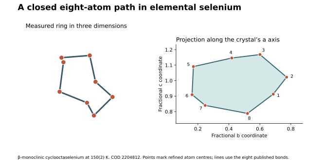

# Knot inputs from elemental phases, gallium through tin

**DERIVED — β-monoclinic selenium gives a closed, unknotted bond polygon.** The neighbors of each eight-membered ring form an unlink in the reported structure. This is a positive result for physical closure and a negative control for detecting a nontrivial knot or link. The object is the polygon joining eight refined mean atomic positions along the eight reported covalent bonds. An isolated selenium atom, a selenium isotope and a ring in a different allotrope are different objects.

## What was read first

Jeromie’s supplied *Element Paper: The Loop Wall* describes the one-period closure of the β-manganese screw as an unknot, and seeks a reproducible closed path for the volume polynomial. The knot harness reports checks on explicitly named knots, mirrors and distinguishing invariants. We applied that same requirement for a specified object before consulting the phase literature. The separate Zenodo landing page for *The Volume of the Knot Potential* did not open in the web tool. The representation-product formula below comes from the supplied research correspondence. [Pinned repository README](https://github.com/dicipler-pixel/votkp-lean/blob/bcedbd9/README.md) · [Knot harness report](https://github.com/dicipler-pixel/votkp-lean/blob/bcedbd9/research/2026-11-12-harness/reports/T1_knots_REPORT.md) · [Volume paper record](https://zenodo.org/records/24040319)

## Selenium — reproducible proof from a structure determination

**MEASURED.** Maaninen, Konu and Laitinen refined β-Se₈ at 150(2) K in space group P2₁/c with four Se₈ rings in the unit cell. Their atom labels give the actual cycle Se1–Se2–Se3–Se4–Se5–Se6–Se7–Se8–Se1. Their eight bond lengths run from 2.3010(15) to 2.3244(13) Å. The fractional coordinate list intentionally retains coordinates beyond the unit interval so the ring is contiguous. The included COD 2204812 file is revision 301803, SHA-256 ac27d99b1c3c9e1d9997917fa41086702ed451ea2e80392132ae3b75dd31eb89. [Primary study, 2004](https://doi.org/10.1107/S1600536804024055) · [Machine-readable CIF](https://www.crystallography.net/cod/2204812.cif)

**DERIVED.** Project along the fractional x direction to (y,z). For each directed edge AB and each other vertex C take (B_y−A_y)(C_z−A_z)−(B_z−A_z)(C_y−A_y). All 8×6 determinants are positive. The minimum is 0.0045492115 in fractional-coordinate units squared. Replacing every input with its independent ±1 reported standard-uncertainty interval gives a conservative minimum lower bound of 0.0044414721. The numbers are exact-rational results printed as decimals. This conditional robustness makes no probability claim. All vertices lie strictly inside the left half-plane of each directed edge apart from its endpoints. The projected octagon is strictly convex. Moving its height continuously to a constant preserves the embedded loop since the projection stays one-to-one on it. Equivalently, joining each edge to the mean of the eight vertices creates an embedded fan disk inside the 3D convex hull: the projected triangle interiors are disjoint. The physical closure therefore represents the unknot. A deliberate swap of vertices 3 and 6 fails the convexity check.

**DERIVED.** To test for links, bound the complete ring by its coordinate-wise extrema including the uncertainty boxes. For an original interval [a,b] and symmetry-copy interval [c,d], a potentially overlapping integer translation m must satisfy ceil(a−d) ≤ m ≤ floor(b−c). Use all three coordinates and all four symmetry operators as given in the CIF. The identity passes only at shift (0,0,0), which identifies the same ring. Each of the other three operators has an empty translation range in at least one coordinate. Crystal symmetry reduces every pair of distinct ring copies to this reference comparison. Thus every pair of distinct bounding boxes is disjoint in the periodic lift to physical space. Fractional coordinates use a nonsingular affine transform for this measured cell (a,b,c positive, α = γ = 90°, β = 92.95°), preserving separation and embeddedness. Each fan disk lies within its own disjoint box, so every finite collection of rings is an unlink. This tests all periodic neighbors, including those outside the conventional cell. A model of instantaneous thermal trajectories would require different input.

**DERIVED.** For one such polygon, normalized Alexander, Jones and HOMFLY–PT polynomials all equal 1. Every color of the reduced sl₂ colored Jones polynomial also gives 1. In a common unreduced, zero-framing convention, color N (the N-dimensional representation) gives the quantum integer [N], so specifying normalization and framing matters. These single-ring values do not assign the same invariants to the entire crystal or an atom. The representation product supplied by Jeromie is P_K(x)=∏ρ(x−exp(λV₀(ρ))). A choice of admissible representations/geometries, their multiplicities, potential normalization and scale for the unknot complement is required to evaluate it. The solid-torus unknot complement has no complete finite-volume hyperbolic knot geometry. Inserting a unit-normalized HOMFLY value, zero volume, or an empty product by default does not supply those missing definitions. [HOMFLY with Alexander/Jones specializations, 1987](https://doi.org/10.1016/0040-9383(87)90025-5) · [KnotInfo normalization](https://knotinfo.org/descriptions/jones_homfly_kauffman_description/polynomial_defn.html) · [Both colored-Jones conventions, 2021](https://doi.org/10.1134/S1995080221110056)

To reproduce, from this directory run:

```sh
python3 selenium_ring.py COD_2204812.cif
python3 selenium_neighbors.py COD_2204812.cif
```

## Elemental phases and tempting false matches

| Element and phase | Evidence checked | What enters the V1 ledger |
|---|---|---|
| Germanium, guest-free type-II clathrate Ge₁₃₆ | **MEASURED** synthesis and structure of an elemental cage network. | A specific physical net and its cage faces are legitimate structural objects. A cage graph has branching vertices. A knot assignment requires one specified embedded cycle, or several disjoint cycles for a link. The paper establishes the net. [2006](https://doi.org/10.1038/nature05145) · [2007](https://doi.org/10.1002/anie.200604586) |
| Arsenic, grey elemental solid | **MEASURED/DERIVED** STM, photoemission and modeling identify coupled bulk, surface and step-edge topology. | A measured step-edge mode does not furnish the closed 3D curve and embedding needed here. [2024](https://doi.org/10.1038/s41586-024-07203-8) |
| Selenium, trigonal | **DERIVED in source** spin texture in a structurally chiral crystal and Weyl nodes in band calculations. | The chain runs between cells. A Weyl point is zero-dimensional. A closed test surface enclosing it is a separately chosen surface. None identifies a closed knotted trajectory. Compare the measured β-Se₈ bond geometry above and the crown-shaped rings separately determined for γ-Se₈. [2015](https://doi.org/10.1103/PhysRevLett.114.206401) · [γ phase, 1980](https://doi.org/10.1039/DT9800000624) |
| Strontium, fcc | **DERIVED in source** ab initio nodal lines near the Fermi energy with spin–orbit interaction omitted and a quantized Berry phase. | A Berry-phase test loop around a nodal line does not identify a second physical nodal line linked to it. [2017](https://doi.org/10.1038/ncomms14022) |
| Zirconium, pure hexagonal crystal | **DERIVED in source** DFT type-II nodal line in the k_z=0 plane and nodal surface at k_z=π without spin–orbit coupling. Including SOC opens small gaps at the studied crossings. | The reported objects have dimensions one and two. The authors supply no pair of disjoint linked loops. The well-known zirconium silicon sulfide measurements concern a compound. [Elemental zirconium, 2020](https://doi.org/10.3389/fchem.2020.585753) · [ZrSiS, 2019](https://doi.org/10.1126/sciadv.aau6459) |
| Palladium, elemental metal | **MEASURED** quantum oscillations determine orbit areas and Fermi-sheet geometry, including an open hole sheet. | A cross-sectional area or frequency does not specify two linked closed trajectories. A well-matched positive nodal-link paper concerns intermetallic SnPd₃ and PbPd₃. [Elemental Pd, 1981](https://doi.org/10.1103/PhysRevB.23.462) · [1999](https://doi.org/10.1103/PhysRevB.59.12177) · [Intermetallics, 2018](https://doi.org/10.1103/PhysRevB.98.035130) |
| Tin, epitaxial grey α-Sn on InSb(111) | **MEASURED** ARPES bulk Dirac cones in elemental tin films, with strain included in the interpretation. | A cone apex or constant-energy cut does not identify linked lines in the bulk Brillouin torus. [2017](https://doi.org/10.1103/PhysRevLett.118.146402) |

**Search result.** For the 20 elements from gallium through tin, no nontrivial phase-specific assignment to a closed knot or pair of disjoint linked nodal lines was identified in the sources examined. The strongest positive objects here are the selenium bond cycle and the germanium cage net. For gallium, bromine, krypton, rubidium, yttrium, niobium, molybdenum, technetium, ruthenium, rhodium, silver, cadmium and indium, the broad search supplied no candidate sufficient for assigning a polynomial. The screening was more detailed for arsenic, selenium, zirconium, palladium and tin. These outcomes do not rule out other allotropes, band pairs, or finite embedded cycles. Knotted optical fields in a medium and Hamiltonians engineered in a simulator identify different objects. The linking number of a pair of null-homologous disjoint curves in a Brillouin torus requires explicit periodic continuation. Touching nodal chains and one-dimensional cuts through a spectrum cannot substitute for those inputs.

**Set aside, with why.** Search terms included “nodal link”, “Hopf link”, “linked Fermi surfaces”, “nodal knot”, “crystal net”, “elemental” plus the target names, and targeted queries distinguishing pure metals from compounds. A 2025 survey reports 113 candidate phonon Hopf-link materials. In the authors’ arXiv ancillary Supporting Information, Tables S10–S12 yielded 114 formula-bearing rows, 112 distinct Materials Project IDs (mp-2632 and mp-541568 each appear twice). Every one of those 114 rows has at least two different element symbols. We retain the authors’ headline count and the independently extracted table count separately. That screen concerns phonons. The attached table audit can be repeated from the arXiv source tarball. Abstract model constructions, simulated knots, and multiple independent interpenetrating diamond nets do not demonstrate a linked object in one measured elemental phase. [2025 phonon survey](https://doi.org/10.1103/zvt2-yb2p) · [Authors’ preprint and ancillary data](https://arxiv.org/abs/2412.01280) · [Explicit abstract nodal-link constructions, 2017](https://doi.org/10.1103/PhysRevB.96.041103) · [Interpenetrating crystal nets, 2015](https://doi.org/10.1107/S2053273314019950)

**Falsifiers.** The single-ring projection certificate fails if a reported bond is missing or changed, or the convexity witness fails on the proposed coordinates. A failed convexity witness alone leaves knot type undecided. The periodic box certificate fails if a nonidentical copy overlaps the reference in all three coordinates. Such overlap alone leaves linking undecided. A physically specified nontrivial knot or disjoint link in a measured or modeled elemental phase changes the literature verdict for that object. Extending that result to an isolated atom would require an additional atom-to-curve construction.


