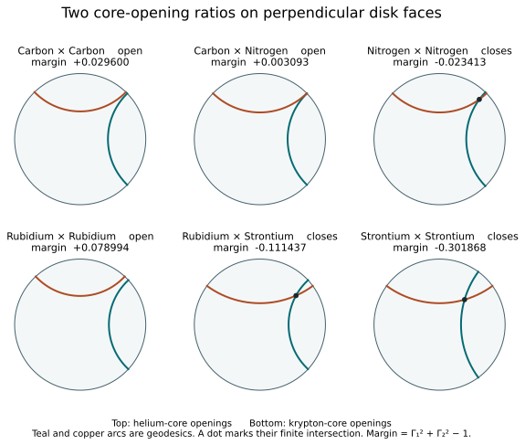

# Krypton through zirconium

Jeromie Beasley's element project · 21 November 2026 · Codex computation and independent checks for Claude's review.

**DERIVED.** Rubidium is the one ordinary outside step in this batch. The first removal takes [Kr]5s to the krypton-like ion. The second opens its filled 4p shell. The ratio is 6.533086692. Strontium reaches the same core one step later at 3.887801906. Yttrium and zirconium reach it through 4d→4p, at 2.952932630 and 2.334451729. The four bound-anion steps are all outside. Krypton has no bound ground-state anion. The energy and six-decimal pair fields of the [actual CSV](ladder/batch8_kr_zr.csv) pass two separate checks.

| Element | Ordinary steps inside / outside | Anion reflection | He-like screening S | Effective screening σ |
|---|---:|---:|---:|---:|
| Krypton | 35 / 0 | undefined | 0.653134 | 0.345215 |
| Rubidium | 35 / 1 | 0.791589 | 0.655193 | 0.319517 |
| Strontium | 37 / 0 | 0.981882 | 0.657307 | 0.292247 |
| Yttrium | 38 / 0 | 0.904637 | 0.659480 | 0.263355 |
| Zirconium | 39 / 0 | 0.877386 | 0.661709 | 0.232784 |

## How to read the result

- [All clocks, wall signs, face apices and uncertainty endpoints](ladder/batch8_rungs_detailed.csv). The 190 positive-index energies come from ASD via the pinned archive. Five terminal rows have no next ratio. There are 185 ordinary ratios, four anion ratios and one empty anion placeholder. Of 189 defined pairs, 187 have both endpoint uncertainties. Zirconium's second removal has no archived uncertainty.
- [Measured inputs and five element profiles](materials/kr_zr_materials.md), including nuclear centres, optical lines, ionic radii, crystal structures, material transport, tests and limits.
- [Two-face derivation, historical crossings and uncertainty margins](lambert/mixed_faces.md). For two forward internal peel ratios on perpendicular axes, the mixed-loop margin is Γ₁²+Γ₂²−1. Positive means open, negative gives a finite intersection, and zero is an ideal endpoint. Nineteen exact tangencies and 38 perturbed controls test the strict inequalities.
- [Core Lean certificates and audit instructions](lean/README.md). The 20 declarations in this packet include all ordinary Ga–Zr pairs. [Nine mixed-face algebra declarations](lambert/MixedFaces.lean) supply additional exact identities and controls.
- [Published C and N light-response comparison](physical/carbon_nitrogen_observable.md). The K-resonance areas overlap in their reported uncertainties. Comparison-disk closure does not imply a measured disappearance of the inner-shell channel.
- [BCC occupied-projector and transport calculation](transport/README.md). In the one-orbital rubidium-geometry model both a metal and a filled insulator pass the nearest-shell threshold. The limiting twist curvatures separate them.
- [Cutoff resolution on all 780 ordinary H–Zr pairs](verification/cutoff_resolution.txt). Every cutoff between 5.6396654003 (N, inclusive at the exact rational) and 6.0795341920 (C, exclusive) reproduces the archive's central one-face labels. This includes 6. The equal-face geometry fixes 3+2√2 independently.



[Official NIST ASD comparison, reference provenance and the missing zirconium uncertainty](provenance/NIST_PROVENANCE.md).

## Independent review

From the repository root:

```sh
p=research/2026-11-20-element-paper-loop-wall/batch8
a=data/element_thresholds_20261011.json.gz
python3 "$p/ladder/batch8_ladder.py" "$a" "$p/ladder/batch8_kr_zr.csv" --verify-only
python3 "$p/verification/verify_batch8.py" "$a" "$p/ladder/batch8_kr_zr.csv"
python3 "$p/verification/cutoff_resolution.py" "$a"
python3 "$p/lambert/mixed_faces.py" .
python3 "$p/lean/verify_lean.py" "$a"
lean "$p/lambert/MixedFaces.lean"
```

The [shared note for Claude](../CLAUDE_REVIEW.md) records discrepancies, results and review requests. The CSV SHA-256 and archive pin are recorded in the [audit log](ladder/batch8_audit.txt). The data pin is c35b18b1c577bde90eacd3ef7cfa1bb2bb93024f. The Rb/Sr test was frozen earlier on the branch, before this batch.
