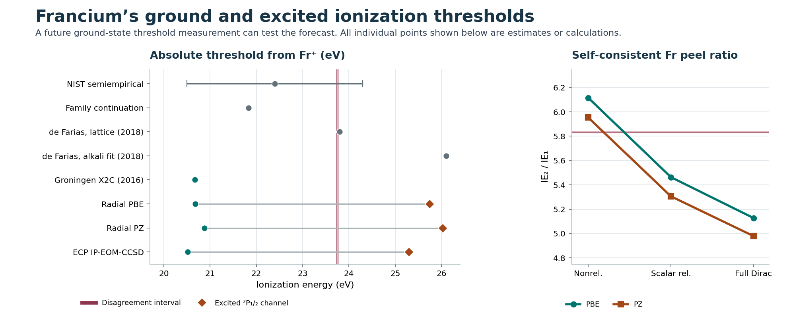

# Francium’s helium-core analogue at the radon shell

Jeromie Beasley’s alkali opening forecast and independent atomic-structure checks. Work started 21 November 2026 UTC and continued on 22 November UTC. Here the isotope-independent electronic model removes a neutral 7s electron and then a 6p electron from closed-shell Fr⁺. Throughout, IE₂ denotes the **lowest threshold from ground-state Fr⁺ to ground-state Fr²⁺**. The measured neutral denominator is 4.0727411(11) eV. The sign forecast is still open.

## What a future measurement would decide

**DERIVED** The registered raw-energy continuation gives `z_Fr = 2 z_Cs − z_Rb = 5.361114976666759`, equivalent to 21.8344333073 eV for IE₂. Wall and rival have central-energy thresholds 23.7376746993 eV and 23.7734875060 eV. Their 35.8128067 meV separation is small. With the adopted IE₁ half-width, even at the best possible midpoint a symmetric IE₂ half-width must be strictly below 17.8999872 meV for its entire box to fit in the disagreement interval. A robust ground threshold below the first boundary supports the directional prediction. A threshold above it falsifies that direction. Selecting a physical wall requires an independently observed outcome determined by that wall.

**MEASURED / EVALUATED** NIST ASD 5.12 (2024) lists Fr IE₂ as **[22.4] ±1.9 eV**, a semiempirical determination labelled L16139. The lower and upper ends 20.5–24.3 eV span both cutoffs. NIST identifies the residual ion as 6p⁵ ²P°₃/₂. The Fr II ¹S₀ limit printed in the *neutral* Fr I Rydberg series is IE₁. The accessible sources examined here supplied no independent ground-channel Fr II ionization measurement. The original bibliography title behind L16139 has not been independently resolved in this audit. [NIST ASD Fr levels and limits](https://physics.nist.gov/cgi-bin/ASD/ie.pl?at_num_out=on&biblio=on&e_out=0&el_name_out=on&ion_conf_out=on&level_out=on&seq_out=on&shells_out=on&spectra=Fr&unc_out=on&units=1) · [Sansonetti, neutral-Fr spectroscopy, 2007](https://www.nist.gov/system/files/documents/srd/jpcrd362007497p.pdf)

**MEASURED** In a genuine measurement of charge states in Berkeley’s FIONA apparatus, ²⁰⁸Fr exited as 98(1)% Fr⁺ and 2(1)% Fr²⁺. Figure 2.20 put the NIST 22.4-eV input on the horizontal axis. It did not determine that coordinate experimentally. The charge-state result establishes that the two charge states could be detected in those runs. [Kwarsick PhD thesis, 2019, Table 2.2 and Fig. 2.20](https://escholarship.org/content/qt3s27j64v/qt3s27j64v.pdf)

## The continuation rule's three earlier opportunities

**DERIVED** Each line uses the identical two-prior-period rule and only earlier archived inputs for that forecast. All three measured targets fell outside when the rule predicted inside. The errors shrink with period, but three correlated errors establish no calibrated uncertainty at Fr. The registered rule and its forecast must be retained as written.

| Prior pair | Target | Forecast z | Archived z | Forecast IE₂ − archived IE₂ (eV) |
|---|---|---:|---:|---:|
| Li, Na | K | 4.373717 | 7.285752 | -12.640164 |
| Na, K | Rb | 5.370171 | 6.533087 | -4.857648 |
| K, Rb | Cs | 5.780421 | 5.947101 | -0.649035 |
| Rb, Cs | Fr | 5.361115 | pending measurement | pending |

CSV outputs, forecast errors and exact archive digest come from `archive_audit.py`. It verifies the compressed file SHA-256 before reading values. [Pinned archive](https://github.com/dicipler-pixel/votkp-lean/blob/893bd1018b22fcc575194196975fc9650d2006fb/data/element_thresholds_20261011.json.gz)

## Prior calculations and an explicit opposing prediction

**DERIVED FROM PUBLISHED THEORY** Koen van der Schoor’s 2016 Groningen bachelor thesis, supervised by Anastasia Borschevsky, gives in Table 4 Fr IE₂ = **20.673 eV** with relativistic X2C CCSD(T) and the stated Dyall quadruple-zeta basis. Its Rb and Cs results differ from their archived IE₂ by −0.133 and −0.128 eV. The table labels a 20.02-eV Fr value as a neural-network calculation in footnote b, citing Sigman and Rives (1994). Our numeric transcription for the latter relies on the thesis. [Groningen thesis, Table 4](https://fse.studenttheses.ub.rug.nl/14531/1/report.pdf#page=10) · [Sigman and Rives](https://doi.org/10.1021/ci00019a021)

**DERIVED** Keeping both energies internally consistent makes a direct relativity control. For Fr, the thesis gives

$$z_{\rm NR}=21.765/3.582=6.0762144,\qquad z_{\rm X2C}=20.673/4.052=5.1019250.$$

The first ratio is outside and the second is inside. With measured IE₁ in both denominators even the nonrelativistic numerator yields an inside ratio, concealing the change. The exact log attribution from the displayed thesis values is

$$\Delta\ln z=\ln(20.673/21.765)-\ln(4.052/3.582)=-0.051475-0.123289.$$

An increase in neutral 7s binding supplies 70.55% of this model’s decrease in log ratio. Changing only the numerator gives 5.771357. Changing only the denominator gives 5.371422. Each lies inside.

**HYPOTHESIS / PRIOR THEORY** In 2018, R. F. de Farias estimated Fr IE₂ as **23.80 eV**, 62.3 meV above the geometric threshold and 26.5 meV above the empirical rival. The same author also published **26.10 eV** in 2018 by regressing the first two thresholds of Na through Cs. These are two estimates from one author. The 2024 article explicitly plotted alkali IE₂/IE₁, so using this ratio down the group already has published precedent. Its printed expression 23.80/4.97 gives 4.79. Its printed quotient 5.85 is consistent with the rounded 4.07-eV IE₁ given elsewhere. Using the archive precision gives 5.843730. No model in this paragraph provides a new experimental datum or a calibrated uncertainty interval. [2018 Mendeleev Communications](https://doi.org/10.1016/j.mencom.2018.05.026) · [2018 Chemistry Research Journal](https://chemrj.org/download/vol-3-iss-1-2018/chemrj-2018-03-01-113-117.pdf) · [2024 Mens Agitat, Fig. 1](https://mensagitat.org/data/documents/19-2024-11-13.pdf)

**DERIVED** Why the two empirical formulas separate is already visible in the neutral thresholds. Fr IE₁ lies 63.14% of the way from Cs IE₁ back toward Rb IE₁, while Fr is one full period beyond Cs. Interpolating IE₂ linearly in measured IE₁ using only Cs and Rb gives 25.76658 eV. A least-squares refit of the published Na–Cs predictor to the pinned archive gives `IE₂ = 19.722436 IE₁ − 54.196420 eV`, hence 26.12796 eV for Fr. These revisit the regression's stated method; the original author's 26.10 eV stays in the literature ledger. Using period index to extrapolate moves in the opposite direction. A measurement can decide whether the first outer-s energy tracks the next p-shell threshold after the neutral trend turns upward.

## An all-electron calculation that can be rerun

**COMPUTED / DERIVED** We actually ran Quantum ESPRESSO 6.7 `ld1.x` with full radial electronic relaxation, including the core. The primary functional was PBE, with Perdew–Zunger LDA as a sensitivity check. For each of Rb, Cs and Fr we switched the one-electron relativistic Hamiltonian between Schrödinger, scalar relativistic and Dirac modes, holding the spherical spin-averaged treatment fixed. In full Dirac mode we explicitly checked the final-state occupations for both p holes. Two log-radial mesh spacings (0.0125 and 0.00625), radius 100 bohr, xmin −9 and SCF stopping tolerance 10⁻¹² yielded **120 converged states in 36 sets**. Across these comparisons the largest IE₂ mesh difference was 0.000687 eV. This quantifies grid sensitivity inside these approximations. The frozen status of the experiment, the code run settings and calculation status are separate. [QE `ld1.x` reference](https://www.quantum-espresso.org/Doc/INPUT_LD1.html)

| Atom and model | IE₁ (eV) | IE₂, lower channel (eV) | Internally calculated z | Upper channel (eV) |
|---|---:|---:|---:|---:|
| Rb, full Dirac PBE | 4.153337 | 27.289426 | 6.57048 | 28.270099 |
| Cs, full Dirac PBE | 3.863124 | 23.088258 | 5.97658 | 24.903512 |
| Fr, nonrelativistic PBE | 3.575148 | 21.864079 | 6.11557 | — |
| Fr, scalar-relativistic PBE | 4.035091 | 22.046470 | 5.46369 | — |
| Fr, full Dirac PBE | 4.032881 | 20.679688 | 5.12777 | 25.742836 |
| Fr, full Dirac PZ | 4.193290 | 20.879940 | 4.97937 | 26.021041 |

**DERIVED** The scalar relativistic step chiefly increases IE₁ and already moves the self-consistent Fr ratio through the wall. Switching from scalar to full spin–orbit treatment lowers the Fr ground-channel IE₂ by a further 1.366782 eV while barely changing its IE₁. This mechanism has observable consequences in the state assignments. The PBE error in IE₂ against the Rb and Cs archive values is −0.000114 eV and −0.069192 eV. That exceptionally small Rb residual does not transfer as an uncertainty bound for Fr. Full Dirac PZ puts Cs inside at z ≈ 5.8139 using its own neutral threshold, while archived Cs is outside at 5.9471. Keep this false control. PBE uses conventional exchange-correlation, with no explicit isotope, nuclear recoil, Lamb shift, many-body Breit or higher-order correlation corrections.

**HYPOTHESIS AND FALSIFIER** A future ground-state Fr⁺ photoionization experiment should distinguish a lower onset to Fr²⁺ 6p⁵ ²P°₃/₂ and an excited threshold to the ²P°₁/₂ level. PBE puts those two channels respectively below and above **both** cutoffs. Even when the optical response to the higher channel is stronger, only the lower residual-ion ground channel defines IE₂. The distinct electronic calculations give targets for spectroscopy. A measurement assigning the wrong residual state cannot score the directional forecast. An experiment finding the two assigned thresholds on the same side would falsify this additional state-dependent sign pattern.

## Isoelectronic checks

**DERIVED** Holding N=86 and varying nuclear charge compares Rn, Fr⁺, Ra²⁺ and Ac³⁺. Linear interpolation of the neighboring archive gives 20.87425 eV for Fr⁺. Quadratic interpolation through charges 0, 2, 3 gives

$$ E(1)=E(0)/3+E(2)-E(3)/3 = 10.7485/3+31.0-44.8/3=19.6495\ \mathrm{eV}.$$

The three source grades are experimental, theoretical and semiempirical respectively. Ra²⁺ carries a ±1.6-eV entry and Ac³⁺ ±1.4 eV. Ignoring the unknown Rn width, their worst-case contribution alone is ±2.067 eV; interpolation error is additional. Rn's absent numerical width has been preserved. Across the earlier noble-core sequences the corresponding quadratic interpolator misses the E-grade Na⁺, K⁺, Rb⁺ and Cs⁺ targets by +0.0480, +0.0449, +0.0581 and +0.0796 eV, respectively. Two of those neighbor inputs are semiempirical. Li⁺ has a theory-grade target. `radonlike.csv` covers all Z=86–118, with 15 missing rows for Rf through Og.

**COMPUTED / DERIVED** An additional 42 runs used the same fine grid and full Dirac functionals on the N=86 sequence from Rn through U. Quadratic interpolation from the model’s own Rn, Ra²⁺ and Ac³⁺ values gives 20.7354 eV (PBE) and 20.9348 eV (PZ), 0.0557 and 0.0549 eV above their direct model calculations. PBE gives 32.0936 eV for Ra²⁺ and 44.7661 eV for Ac³⁺. The 1.0936-eV shift of the low-precision Ra²⁺ archive midpoint largely explains why the archive-only quadratic estimate is lower. A radial model establishes neither source corrections nor new measured entries. The 7-row sequence and both channels appear in `sequence_energies.csv`.

## Which isotope the denominator belongs to

**MEASURED AND DERIVED** The underlying neutral thresholds compiled by Sansonetti (2007) are 32848.872(9) cm⁻¹ for ²¹²Fr and 32848.0(3) cm⁻¹ for ²²¹Fr. With the modern exact SI conversion `hc/e = 0.00012398419843320026 eV·cm`, the first gives 4.0727410644 eV and rounds to the pinned 4.0727411 eV. The second gives 4.07263295 eV. The central wall moves from 23.73767449 to 23.73704436 eV, a difference of 0.63014 meV. Their propagated one-input half-widths are 0.00650 and 0.21679 meV respectively. A new Fr II experiment should use the measured isotope’s own IE₁, or state the uncertainty penalty when using a proxy isotope. No isotope shift of IE₂ was inferred here. [Sansonetti, §2 and Tables 5–6](https://www.nist.gov/system/files/documents/srd/jpcrd362007497p.pdf)

## Correlated spin–orbit calculation and fine structure

**COMPUTED / DERIVED** PySCF 2.11.0 was run independently using the small-core nine-valence-electron spin–orbit pseudopotentials of Lim et al. The cation has eight active electrons, the dication seven. The original four-component multiconfiguration Dirac–Hartree–Fock plus Breit energy fit included both charged sectors. Reusing this *theoretical* fit means that a separate implementation is not independent of its source Hamiltonian. We used optimized unrestricted generalized-Hartree–Fock determinants for the two charge states, added second-order spinor correlation, and also solved closed-cation IP-EOM-CCSD for six ionization roots. All input basis exponents and mesh settings are in the scripts. [Lim et al. 2005, §II B and Tables III–IV](https://doi.org/10.1063/1.1856451) · [Author-hosted full text](https://www.researchgate.net/publication/7901519_All-electron_and_relativistic_pseudopotential_studies_for_the_group_1_element_polarizabilities_from_K_to_element_119)

**COMPUTED / DERIVED** The EOM used MP2 natural virtual spinors and preserved complete near-degenerate occupation groups at each cap. At the largest cap it retained 64 virtual spinors for each atom, capturing 99.57% or more of the virtual-density trace. The fractional capture measures retained virtual occupation. It supplies no direct error bound for an excitation energy. The sorted six roots reproduce the fourfold ²P°₃/₂ ground and twofold ²P°₁/₂ upper multiplicities. The squared norm of each Fr right eigenvector in its assigned parent one-hole subspace is 0.9685 or 0.9548 at this setting. These are assignment diagnostics, rather than measured intensity or Dyson pole strengths.

| Ion | EOM lower (eV) | EOM upper (eV) | EOM separation (eV) | Spectroscopic separation (eV) |
|---|---:|---:|---:|---:|
| Rb²⁺ | 27.024825 | 27.911254 | 0.886429 | 0.9143 |
| Cs²⁺ | 22.878010 | 24.529449 | 1.651439 | 1.7169 |
| Fr²⁺ | 20.514854 | 25.290916 | 4.776062 | pending |

**MEASURED / DERIVED** In Rb III the 1972 analysis gives 7374.5(7) cm⁻¹; for Cs III the 2009 compilation gives 13847.3609(10) cm⁻¹. In the nine-electron ECP model the absolute second threshold errors are −0.265 and −0.279 eV for Rb and Cs. Radial PBE's corresponding splitting errors are +0.0664 and +0.0984 eV. Thus model agreement on the signs is more credible than agreement at the 35.8-meV scale. [Rb III primary spectrum](https://opg.optica.org/josa/abstract.cfm?uri=josa-62-12-1467) · [Cs III evaluated data](https://srd.nist.gov/jpcrdreprint/1.3132702.pdf) · [Direct Cs fine-structure transition](https://meetings-archive.aps.org/damop/2005/d6/9/)

**HYPOTHESIS AND FALSIFIER** The residual Fr²⁺ ground-configuration doublet is a separate target. Its magnetic-dipole transition has vacuum wavelength `hc/ΔE`. The ECP-IP-EOM-CCSD, radial PBE and radial PZ estimates span approximately 260 to 241 nm. A direct spectrum of Fr III can check the assignment and energy separation independently of the common absolute threshold. The spread across approximations is not a confidence interval. Combining an independent splitting measurement with both absolute Fr⁺ onsets would test the electronic-state reading.

**COMPUTED / DERIVED** As a separate correlation check, full-virtual-space spinor ΔMP2 gives Fr IE₂ = 20.5610 eV in the 111-function spdf basis. The same calculation with the published Lim et al. dipolar core-polarization correction gives 20.5722 eV, a shift of +0.0112 eV. For Cs these values are 22.9353 and 22.9677 eV. We included both the one-electron and the cross-electron pieces of the squared electric field. Refining radial quadrature from 100 to 180 points changed the correction integrals by less than 4.0×10⁻¹⁵ hartree in this basis. Unmodeled high-order correlation and differences between the theoretical Hamiltonians remain. On a scalar Rb benchmark the custom MP2 integral contraction agrees with PySCF's standard closed- and open-shell implementations within 8.4×10⁻¹⁷ hartree. Direct complex, four-index spinor integrals on a small basis agree with the packed implementation within 2.3×10⁻¹⁶ hartree. These are implementation tests.

## Reproduction

Use the pinned archive with Git blob `0c4e6513b9e7910354585cc1aeab939388537e3f` and SHA-256 `75e67478d9a22ef85fa2d3f6ac36ad2860c6f8f62215127c558438a2cb53f62c`. `archive_audit.py` uses the Python standard library. The all-electron calculations used the Debian Quantum ESPRESSO `6.7-3+b1` package and `ld1.x` v6.7MaX, in single-rank, single-thread runs. The correlated calculations used PySCF 2.11.0, NumPy and SciPy with one BLAS thread. The plotted PNG and PDF use Matplotlib. A command line that reproduces the numerical work from this folder follows.

```sh
export OPENBLAS_NUM_THREADS=1 OMP_NUM_THREADS=1
python archive_audit.py /path/to/data/element_thresholds_20261011.json.gz
python allelectron_control.py /path/to/ld1.x
python sequence_control.py /path/to/ld1.x
python validate_integrals.py
for basis in coarse medium; do
  for atom in Rb Cs Fr; do python atomic_control.py "$atom" "$basis"; done
done > atomic_runs.jsonl
for basis in medium medium-f fine-f; do
  for atom in Rb Cs Fr; do python atomic_control.py "$atom" "$basis" --mp2; done
done > mp2_runs.jsonl
for cap in 24 36 48 60; do
  for atom in Rb Cs Fr; do python eom_control.py "$atom" medium-f "$cap"; done
done > eom_runs.jsonl
for atom in Cs Fr; do python polarization_control.py "$atom" medium-f; done > cpp_runs.jsonl
python summary_check.py
python make_figure.py
```

Figure 1 displays the estimated ground thresholds, separate excited-channel predictions and internally calculated change with the relativistic model. The measured Fr II ground threshold remains an open data cell.


